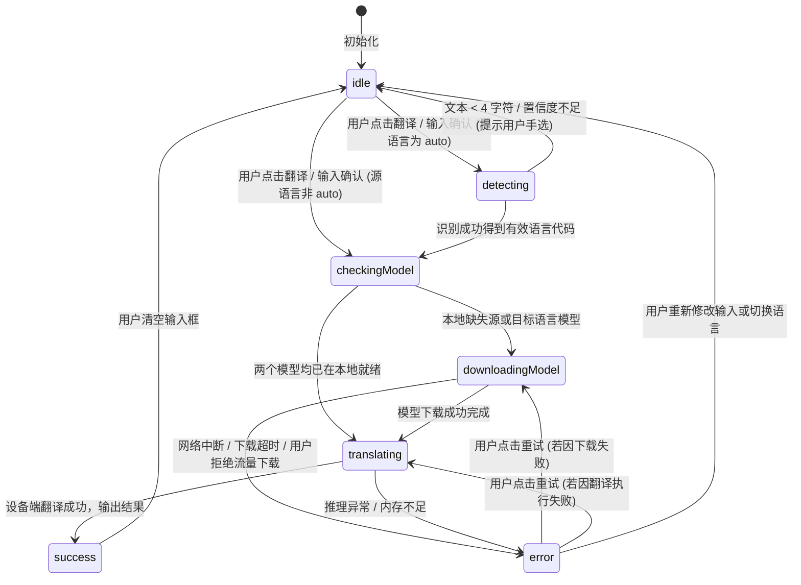

# 状态机与并发规格说明 (State Machine Spec)

> **适用范围**：`lib/features/translate/app_controller.dart` 及相关 UI 观察者  
> **核心原则**：明确的阶段定义、请求失效保护（Request Invalidation）、显式重试机制。

---

## 1. 核心状态定义

### 1.1 阶段枚举 (`TranslationPhase`)

```dart
enum TranslationPhase {
  idle,             // 空闲/等待输入
  detecting,        // 正在进行语言自动检测
  checkingModel,    // 正在检查源/目标语言离线模型是否存在
  downloadingModel, // 正在后台下载所需的离线语言模型 (可能耗时较长)
  translating,      // 模型就绪，正在进行设备端推理翻译
  success,          // 翻译完成，成功产出译文
  error,            // 发生错误 (模型下载失败、不支持语种或翻译异常)
}
```

### 1.2 完整状态类 (`TranslationState`)

| 字段 | 类型 | 说明 |
|---|---|---|
| `input` | `String` | 当前输入的原文（最大 5,000 字符） |
| `sourceLanguage` | `String` | 源语言代码（如 `'auto'`, `'en'`, `'zh'`） |
| `targetLanguage` | `String` | 目标语言代码（如 `'zh'`, `'en'`，**严禁为 'auto'**） |
| `detectedLanguage` | `String?` | 自动识别出的语言代码（仅当 `sourceLanguage == 'auto'` 时有值） |
| `phase` | `TranslationPhase` | 当前状态机阶段 |
| `result` | `String?` | 翻译结果（成功时为译文字符串） |
| `error` | `String?` | 错误消息（面向用户的友好提示文案） |
| `requestId` | `int` | 单调递增的请求标识符，用于过期请求失效防抖 |
| `isOfflineReady` | `bool` | 当前选定语种的模型是否已均在本地就绪 |

---

## 2. 状态转移图与转移条件



---

## 3. 并发控制与过期请求失效机制 (Request Invalidation)

离线模型下载或长文本翻译属于异步耗时任务（几百毫秒至数十秒）。为防止快速输入或切换语言引起的乱序覆盖：

1. **单调递增 Sequence**：
   每次进入翻译流程，执行 `final currentRequestId = ++_requestCounter;` 并同步至 `state = state.copyWith(requestId: currentRequestId);`。
2. **异步中途检查**：
   在下列异步节点返回后，**必须**检查当前请求是否依然有效：
   * 语种识别完成时；
   * 模型状态检查完成时；
   * 模型下载完成时；
   * 设备端翻译完成时。
   
   ```dart
   if (currentRequestId != _requestCounter) {
     // 用户已发起新翻译或修改了输入，丢弃当前陈旧结果
     return;
   }
   ```
3. **输入变化保护**：
   用户在输入框中敲击修改内容时，若当前处于 `downloadingModel` 或 `translating`，新的修改将触发状态重置，丢弃旧请求结果，防止上一段文本的译文覆盖当前新输入。

---

## 4. 异常处理与重试策略

| 异常场景 | 错误提示文案 | 状态转移 | 重试行为 |
|---|---|---|---|
| **文本过短 / 无法识别** | `文本过短或无法确定语言，请手动选择语言` | 回退至 `idle`，保留输入 | 用户手动点击语言选择器选择明确语种 |
| **同语种翻译** | `源语言与目标语言相同，无需翻译` | 回退至 `idle`，保留输入 | 提示用户调整目标语言 |
| **模型下载失败** | `语言模型下载失败，请检查网络后重试` | 转入 `error` 阶段 | UI 显示“重试”按钮，点击重新触发 `downloadModel` |
| **设备端推理失败** | `翻译服务暂时不可用，请稍后重试` | 转入 `error` 阶段 | UI 显示“重试”按钮，点击重新触发 `translate` |
